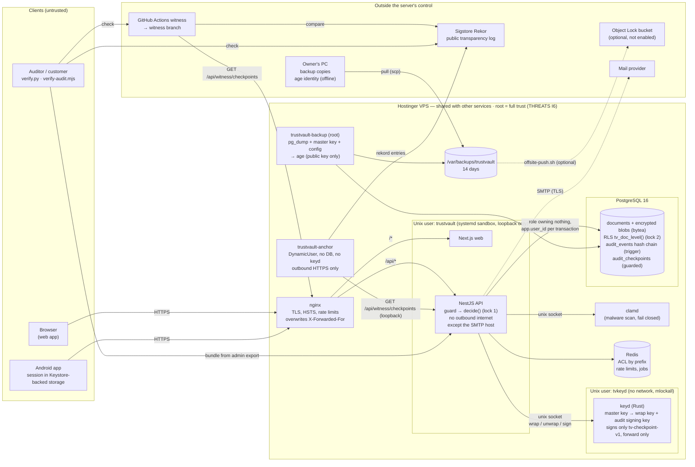

# Security architecture

Components, trust boundaries and where each secret lives, as deployed on 2026-11-03. Text version and details: README "How it works", [PLAN.md](PLAN.md); threats per boundary: [THREATS.md](../THREATS.md).

## Components and trust boundaries

## Boundaries, what crosses them, and what protects them

| # | Boundary | What crosses | Protection | Residual risk (THREATS) |
|---|---|---|---|---|
| 1 | Internet → nginx | HTTPS from browsers, the Android app, witnesses | TLS, HSTS, per-IP rate limits, header normalisation | volume DoS (out of scope) |
| 2 | nginx → API | HTTP on loopback | API binds to loopback only; Origin + session + CSRF + second factor + role in one guard; every document route goes through `decide()` (deny by default) | logic bugs in the API (A*, S*) |
| 3 | API → database | SQL as a role that owns nothing | row-level security written separately from the API code (two locks); triggers for grant rules; audit append-only and chained by the database | user/group tables rely more on app logic (checklist item 3; **P0 fixes**) |
| 4 | API → keyd | wrap/unwrap/sign over a Unix socket | separate user and process; peer-uid check; keyd signs only forward checkpoint messages; never returns the master key | keyd unwraps any key the API asks for (checklist item 5; **in progress** `keyd-ledger`) |
| 5 | Server → outside records | public checkpoint data only | anchor service with no secrets; GitHub witness holds no server credential and the server holds none for it | the last 1–2 minutes before a compromise (L5) |
| 6 | Server → backups | encrypted archives | `age` to an offline public key | backups on the same server until pulled; single key copy (BACKUP_DR §8) |
| 7 | Root on the server | everything | **accepted** (I6); detection through boundary 5; recovery through boundary 6 | full confidentiality loss under root |
| 8 | Client devices | downloaded files, sessions | session expiry, revocation on next request, Android encrypted storage | copies already downloaded; rooted phones (S13) |

## Where each secret lives

| Secret | Location | Readable by | In backup |
|---|---|---|---|
| keyd master key | `/etc/tvkeyd/master.key` → systemd credential | root, keyd | yes |
| Per-version data keys | `document_blobs.wrapped_key`, wrapped by keyd | nobody unwrapped at rest | yes (wrapped) |
| Audit signing key | derived in keyd (HKDF `tv-audit-sign-v1`) | keyd | via the master key |
| TOTP secrets | `users.totp_secret_enc`, wrapped by keyd | keyd | yes (wrapped) |
| Database passwords, Redis password | `/etc/trustvault/*.env`, `db.secrets` | root, the `trustvault` group | yes |
| SMTP password | `/etc/trustvault/mail.env` | root, the `trustvault` group | yes |
| Session tokens, reset/invite tokens | only their SHA-256 in the database | — | hashes |
| Password hashes | Argon2id in `users` | — | yes |
| age backup identity | owner's PC, offline (one copy) | the owner | no (never) |
| TLS private key | certbot on the server | root | no |

## Branches changing this picture (not deployed)

Scope as planned against the review checklist; check each branch for what it actually contains before relying on it.

| Branch | Intended change |
|---|---|
| P0 fixes (merging to main) | admin password-set route removed; download/revocation locking; database-level protection for role and membership changes |
| `keyd-ledger` | keyd authorizes unwraps and keeps its own signed unwrap ledger; key rotation and re-wrap tooling |
| `mfa-advanced` | per-role MFA policy, session list and revocation |
| `view-only` | page rendering instead of file download; traceable watermarks |
| `insider-detect` | multi-day baselines and alert aggregation |
| `access-policy` | download approvals, time windows |
| `auth-abuse` | adaptive throttling |
| `supply-chain` | dependency scanning, SBOM, release gates |
| `content-web`, `android-tests` | parser/XSS regression tests; Android security tests |

Update this page when any of them is deployed.
